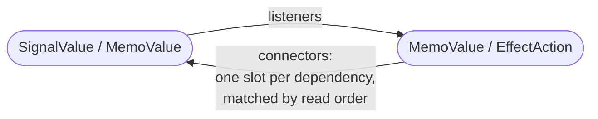
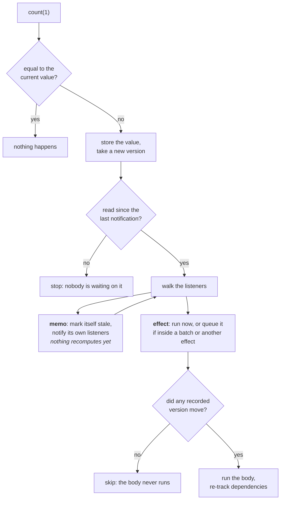

# @lenic/signal

A small, synchronous signals engine for TypeScript. Values know who reads them, and everything
downstream stays correct without you wiring a thing.

[](https://www.npmjs.com/package/@lenic/signal)
[](https://github.com/lenic/signal-engine/blob/main/LICENSE)
[](https://www.npmjs.com/package/@lenic/signal)

> This started as a personal exercise, something to show what I could build while interviewing, and
> it kept growing until it covered the whole feature set.

---

```typescript
import { signal, memo, effect } from '@lenic/signal';

const first = signal('Ada');
const last = signal('Lovelace');

const fullName = memo(() => `${first()} ${last()}`);

effect(() => console.log(fullName()));
// → "Ada Lovelace"

last('Byron');
// → "Ada Byron"
```

No subscriptions to register, no dependency arrays to keep in sync, no teardown to remember.
Reading a value inside a `memo` or an `effect` is the subscription, and the engine works out the
rest.

---

## Why you might pick this one

**It passes a public conformance suite in full.**
[`reactive-framework-test-suite`](https://www.npmjs.com/package/reactive-framework-test-suite)
is 179 cases covering glitch-freedom, dynamic dependencies, batching, disposal ordering, cycle
detection and error recovery. Those are the corners where reactive engines differ in ways nobody
documents. This one passes **179 / 179 with nothing skipped**, plus 93 tests of its own. Run
`pnpm test` and check.

**Everything is synchronous.** A write settles before the next line of your code runs. No
microtask queue, no "wait a tick and it will be consistent". That makes it easy to test, and easy
to follow when something goes wrong.

**Nothing outlives its owner.** Anything created while an `effect` is running belongs to that run:
nested effects, memos, cleanup functions. When the effect re-runs or is disposed, they all go with
it, recursively.

**Errors do not get lost.** An effect that throws does not stop the others from running. Every
error raised during a propagation is collected, and rethrown once the outermost write or batch
finishes: as-is when there is one, as an `AggregateError` when there are several.

---

## Install

```bash
npm install @lenic/signal
pnpm add @lenic/signal
yarn add @lenic/signal
```

---

## API

### `signal(initialValue, options?)`

A value you can read and write. Call it with no arguments to read, with one to write.

```typescript
const count = signal(0);

count();      // → 0     (read)
count(5);     // (write)
count();      // → 5
```

Writing a value that compares equal to the current one changes nothing and notifies nobody.
Equality is `Object.is` by default; pass a `comparer` when that is too strict:

```typescript
const deepEqual = (a: unknown, b: unknown) => JSON.stringify(a) === JSON.stringify(b);
const config = signal({ theme: 'dark' }, { comparer: deepEqual });

config({ theme: 'dark' });   // a new object, but nothing downstream re-runs
config({ theme: 'light' });  // this one propagates
```

`options.name` is an optional label for debugging.

### `memo(getter, options?)`

A derived value. It does not run until something reads it, and the result stays cached until one of
its dependencies actually changes.

```typescript
const items = signal([1, 2, 3]);

const total = memo(() => {
  console.log('summing');
  return items().reduce((a, b) => a + b, 0);
});

total();  // → 6, logs "summing"
total();  // → 6, silent — cached

items([1, 2, 3, 4]);
total();  // → 10, logs "summing"
```

A memo stops propagating when its own value comes out unchanged, so a source that churns without
affecting the result costs you nothing downstream:

```typescript
const n = signal(1);
const isOdd = memo(() => n() % 2 === 1);

effect(() => console.log(isOdd()));  // → true

n(3);  // `n` changed, `isOdd` recomputed, still true → the effect does not re-run
```

It takes the same `comparer` and `name` options as `signal`.

### `effect(fn, options?)`

Runs `fn` immediately, tracks whatever it reads, and runs it again whenever any of that changes.
Returns a function that stops it.

```typescript
const user = signal('ada');

const stop = effect(() => {
  document.title = user();
});

user('grace');      // title updates
stop();
user('katherine');  // nothing happens
```

The first run is always synchronous, whether on creation, inside a batch, or inside another
effect. By the time `effect()` returns, the body has run and its dependencies are live.

**Return a function to clean up after yourself.** It runs before the next re-run, and once more
when the effect is stopped. It runs untracked, so whatever it reads does not become a dependency:

```typescript
const channel = signal('general');

effect(() => {
  const socket = connect(channel());

  return () => socket.close();
});
```

An effect that writes to a signal it also reads does not recurse: the write is noted, and the effect
runs once more after the current run finishes. A cycle that never settles is cut off after 100
rounds with an error, instead of hanging the process.

### `beginBatch()` / `endBatch(level)`

Groups writes so that everything downstream sees one settled result instead of each intermediate
step. Always pair them with `try` / `finally`:

```typescript
import { beginBatch, endBatch } from '@lenic/signal';

const width = signal(10);
const height = signal(20);

effect(() => console.log(width() * height()));  // → 200

const level = beginBatch();
try {
  width(30);
  height(40);
} finally {
  endBatch(level);
}
// → 1200, once — not 600 then 1200
```

Inside a batch, a write takes effect immediately for anyone reading it, but effects wait. They run
as the outermost `endBatch()` returns, not on a later tick. Batches nest. And if the writes cancel
out (set to something else and back again), nothing downstream runs at all.

`beginBatch()` returns the nesting level of the batch it opens, and `endBatch(level)` closes that
level together with any batch still open inside it. Ending a batch that is already closed does
nothing, so ending the outer one first, or ending the same one twice, never leaves later writes
deferred or the batch depth out of step.

### `untrack(fn)`

Runs `fn` and returns its result without recording anything it reads as a dependency.

```typescript
const a = signal(1);
const b = signal(1);

effect(() => {
  console.log(a(), untrack(() => b()));
});

b(2);  // silence: `b` was read untracked
a(2);  // → 2 2
```

Anything created inside `untrack` has no owner either, so an effect started there lives until you
stop it yourself.

---

## Lifecycle

Anything created while an `effect` is running is owned by that run.

```typescript
const outer = signal(0);
const inner = signal(0);

const stop = effect(() => {
  outer();

  effect(() => console.log('inner:', inner()));
});

inner(1);   // → "inner: 1"

stop();     // the nested effect goes too
inner(2);   // silence
```

The same holds when the owner merely re-runs: the previous run's children are disposed before the
new run creates its replacements. Nothing accumulates.

A `memo` is not an owner. Something created while a memo computes belongs to whichever effect is
running at the time, or to nothing.

---

## How it works

Two directions of traffic: readers pull **versions**, sources push **dirty marks**.



Going right: a source that changes marks its listeners dirty.
Going left: a reader records the version of everything it reads.

Dirty means "come and check", not "recompute". The reader wakes up, compares each recorded version
against the current one, and only runs its body if something actually moved. A memo only takes a
new version when its result changes, which is what makes an unchanged result stop propagation dead.

Here is a write, end to end:



### The pieces

| | |
| --- | --- |
| `SignalValue` | A writable source: a value, a version, and its listeners |
| `MemoValue` | A lazy derived source; recomputes on read when stale, and bumps its version only when the result changes |
| `EffectAction` | A side effect; owns whatever is created while it runs, and holds the cleanup it returned |
| `Runnable` | What memos and effects share: the dependency slots, the version check, and re-entrancy protection |
| `globalContext` | The active reader and owner, dependency tracking, and the queue of pending effects |
| `BatchScope` | Nested batch scopes; the outermost one closing is what flushes the effect queue |
| `ErrorScope` | Collects errors across a propagation and rethrows them once it is over |

Dependencies are tracked by **position**. A reader's slots are filled in read order, so a graph
whose shape does not change reuses them in place, with no allocation and no bookkeeping. When the
shape does change, only the slots that disagree get rewired, and reading the same source twice in
one run is folded into the slot the first read already claimed.

Batched writes are snapshotted. When the batch ends, a signal whose value is back to what it was
before the batch also gets its old version back, so readers find nothing changed and skip.

---

## Status

`0.x`, and the internals still move between minor versions. The functions documented above are
stable; the exported machinery (`SignalValue`, `MemoValue`, `EffectAction`, `globalContext`,
`BatchScope` and friends) is there for building on top, and does change.

---

## License

[MIT](./LICENSE)
